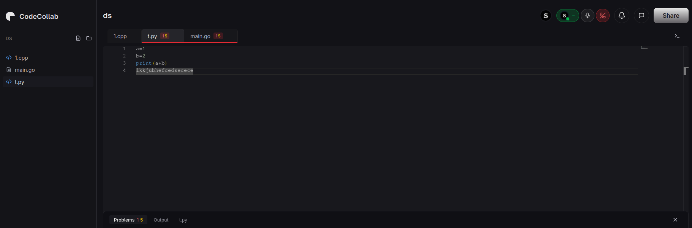
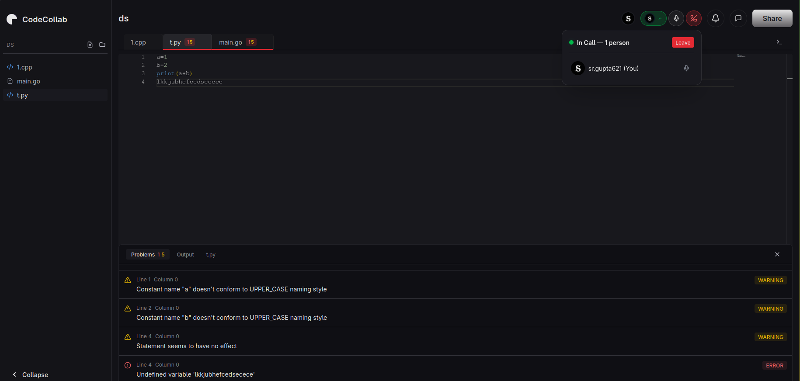
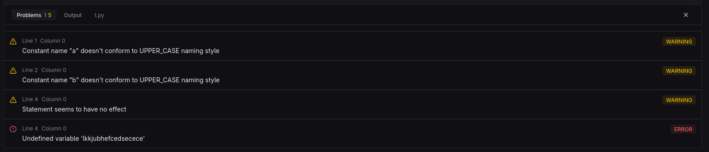

# Code Collab Backend

Real-time collaborative coding platform backend with voice calling support.

---

## Features

### 🖥️ Real-time Collaborative Code Editor

- Live synchronized code editing
- Multi-user cursors and selections
- File tree navigation
- Syntax highlighting support

### 📞 Integrated Voice Calling

- Peer-to-peer voice communication
- In-call controls
- Mute / Unmute functionality
- Participant list

### 🛠️ Error Tracking & Diagnostics

- Real-time syntax error detection
- Line number highlighting
- Error details and quick fixes
- Live compilation feedback

---

## Tech Stack

- **Backend:** Go 1.22+
- **Real-time:** WebSocket (Gorilla)
- **Observability:** Prometheus + Grafana + Loki
- **Documentation:** Swagger/OpenAPI
- **Containerization:** Docker & Docker Compose

---

## Getting Started

### Prerequisites
- Go 1.22 or higher
- Docker & Docker Compose
- Git

### Installation

1. Clone the repository:
```bash
git clone git@github.com:SRAYANSH-GUPTA/code-collab-backend.git
cd code-collab-backend
```

2. Install dependencies:
```bash
go mod download
```

3. Configure environment variables:
```bash
cp .env.example .env
# Edit .env with your configuration
```

4. Start services:
```bash
docker-compose up -d
```

5. Run the server:
```bash
go run main.go
```

Server will start on `http://localhost:8080`

---

## API Documentation

Swagger documentation available at:
`http://localhost:8080/swagger/index.html`

---

## Project Structure

```
code-collab-backend/
├── assets/         # Project screenshots & media
├── config/         # Configuration files
├── handlers/       # HTTP request handlers
├── middleware/     # HTTP middleware
├── models/         # Data models & structs
├── services/       # Business logic
├── utils/          # Utility functions
├── metrics/        # Prometheus metrics
├── docs/           # Documentation
└── main.go         # Application entry point
```

---

## Monitoring Stack

- **Prometheus:** `http://localhost:9090`
- **Grafana:** `http://localhost:3000`
- **Loki:** `http://localhost:3100`

---

## Personal server deployment

Public API: `https://codeolab.srayansh.in`

Authenticated WebSocket: `wss://codeolab.srayansh.in/ws?token=<JWT>`

The server's `/etc/cloudflared/config.yml` routes `codeolab.srayansh.in` to
`http://127.0.0.1:8070`, including WebSocket upgrades on `/ws`.

Run `./deploy.sh` from your local machine. It defaults to `ssh.srayansh.in`,
installs this backend under `/opt/codecollab`, and creates/enables
`codecollab.service` with **PORT=8070**. It prompts for SSH/sudo passwords when
needed. The remote host needs systemd, sudo, curl, tar, flock, and CA certificates;
the local machine needs Go (see `go.mod`), SSH/SCP, tar, and sshpass for password authentication.

The script uploads the local `.env` with restricted permissions along with the
binary and `swagger.yaml`. Review `.env` for production before deploying,
especially Supabase, AWS Lambda, `LOKI_URL`, `PUBLIC_IP`, and TURN settings.
Set `LOKI_URL=disabled` when Loki is unavailable; service logs remain in journald.
`PORT=8070` and `ENV=production` are set by the service and override `.env`.
Set `REMOTE_HOST`, `REMOTE_DIR`, `SERVICE_NAME`, or `ENV_FILE` to override the
deployment defaults. Existing releases are retained, and a failed restart or
`http://127.0.0.1:8070/health` check restores the previous release and service unit.

Route your reverse proxy to port 8070 with WebSocket upgrade support for `/ws`.
Voice also requires the configured UDP range (default 50000–50100) to be reachable
and the correct public IP or TURN configuration. The script does not configure
the proxy, firewall, or the optional monitoring services.

Check AWS Lambda access using the same credentials as the backend:

```bash
go run ./cmd/check-lambda
```

This performs a dry-run invocation for each configured function, verifying AWS
authentication and invoke permission without executing function code. It does
not validate linter output. Configure `AWS_ACCESS_KEY_ID`, `AWS_SECRET_ACCESS_KEY`,
`AWS_REGION`, and the `LAMBDA_ARN_*` variables in `.env`; temporary AWS credentials
also require `AWS_SESSION_TOKEN`. S3 and MinIO are not used by this backend.

### MiniStack linters on the personal server

`lambda/` contains the recovered linter sources and Docker builds for TypeScript
(also used for JavaScript), Python, Dart, Go, and C++. Upload `lambda/` and
`deploy/ministack/` together to a persistent directory on the server, then run:

```bash
bash deploy/ministack/install.sh
```

The installer builds the five images sequentially, starts **MiniStack 1.5.10**
on **127.0.0.1:4566**, and checks valid/invalid samples for every language.
MiniStack is an MIT-licensed AWS emulator requiring no account or subscription;
this setup uses its Lambda container-image support with real Docker execution.
It is a self-hosted emulator, without AWS availability guarantees.

The ready hook registers the functions after every restart, with state stored in
a Docker volume. Keep the uploaded files and Docker images on the server. The
Docker socket lets MiniStack start linter containers; workers are limited to
512 MB and reaped after 30 seconds idle. No S3 or MinIO is needed. Set
`MINISTACK_PORT` to test on a different localhost port. The backend stays on 8070.

For the backend, use an ignored `.env.personal.local` containing your production
Supabase/voice settings plus these Lambda overrides:

```dotenv
AWS_REGION=ap-south-1
AWS_ACCESS_KEY_ID=test
AWS_SECRET_ACCESS_KEY=test
AWS_SESSION_TOKEN=
LAMBDA_ENDPOINT_URL=http://127.0.0.1:4566
LAMBDA_ARN_TYPESCRIPT=codecollab-typescript-linter
LAMBDA_ARN_PYTHON=codecollab-python-linter
LAMBDA_ARN_DART=codecollab-dart-linter
LAMBDA_ARN_GO=codecollab-go-linter
LAMBDA_ARN_CPP=codecollab-cpp-linter
USE_MOCK_LAMBDA=false
USE_MOCK_AUTH=false
```

Deploy with `ENV_FILE=.env.personal.local ./deploy.sh`. An empty
`LAMBDA_ENDPOINT_URL` uses real AWS. The MiniStack smoke check executes valid
and invalid samples for all five functions and verifies the returned diagnostics.

### Grafana and Prometheus

The personal server monitoring stack is in `deploy/monitoring/compose.yml`.
Grafana is available at `https://grafana.srayansh.in` with username `admin`;
its initial password is in the ignored `deploy/monitoring/secrets/admin_password`
file. Keep the secrets directory private and out of Git. The server copy's
password file must be readable by the Grafana container (the parent directory
is mode 700, and the file is mode 644 for the Docker secret mount).

Upload `deploy/monitoring/` to the server, then start or update it with
`docker compose -f deploy/monitoring/compose.yml up -d`. Both containers use
host networking with loopback-only listeners: Grafana on 3000 and Prometheus
on 9090. Cloudflare Tunnel publishes only Grafana. Prometheus scrapes the
backend on `127.0.0.1:8070` every 15 seconds and retains up to seven days or
2 GB of metrics in its volume. Grafana provisions the **CodeCollab Metrics**
dashboard automatically. Its panels cover HTTP requests, latency, status codes,
and Go runtime metrics; logs remain in the backend's systemd journal.

## Contributing

1. Fork the repository
2. Create your feature branch
3. Commit your changes
4. Push to the branch
5. Open a Pull Request

---

## License

MIT License
